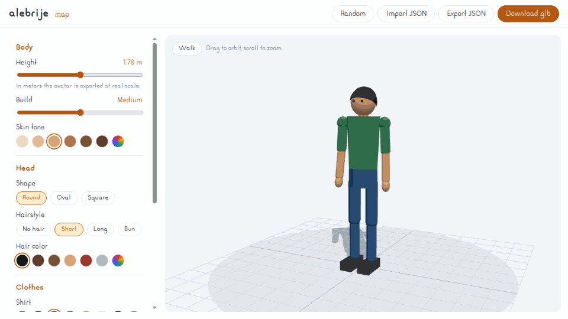

# <picture><source media="(prefers-color-scheme: dark)" srcset=".github/assets/icon-dark.svg"></picture> alebrije

[](https://www.npmjs.com/package/alebrije)
[](https://bundlejs.com/?q=alebrije)
[](LICENSE)

Headless low-poly avatars for three.js: skinned humanoid, walk and idle clips, glTF export, MapLibre and GeoServer.



**[Live demo](https://ghegar.github.io/alebrije/)**

alebrije owns the avatar: a small JSON definition — height, build, skin tone, head shape, hair,
clothes, glasses and cap — becomes a skinned humanoid with `walk` and `idle` clips, ready for an
`AnimationMixer` or to download as binary glTF. You own the renderer, scene, lights, camera and every
control: it ships no styles and no UI, only the model, its mixer and the values to build an editor.

## Install

```bash
npm install alebrije three
```

| Entry | What it is | Needs |
|---|---|---|
| `alebrije` | Definition, builder, player and glTF export | `three >= 0.186` |
| `alebrije/react` | `useAvatarPlayer` | `react >= 19` |
| `alebrije/geo` | Lon/lat math, local frame, ground, walker and routes | `three >= 0.186` |
| `alebrije/geoserver` | WFS avatars and routes, WCS and WMS elevation | nothing |
| `alebrije/maplibre` | Custom layer that draws avatars on a map | a MapLibre map, v4 or v5+ |

## Quick start

```ts
import { HemisphereLight, PerspectiveCamera, Scene, Timer, WebGLRenderer } from 'three';
import { createAvatarPlayer, randomAvatar } from 'alebrije';

const renderer = new WebGLRenderer({ antialias: true });
document.body.append(renderer.domElement);
const scene = new Scene().add(new HemisphereLight('#ffffff', '#8899aa', 2));
const camera = new PerspectiveCamera(40, 1, 0.1, 50);
camera.position.set(0, 1, 4);
const player = createAvatarPlayer(randomAvatar(), { clip: 'walk' });
scene.add(player.model);
const timer = new Timer();
renderer.setAnimationLoop((time) => {
    player.update(timer.update(time).getDelta());
    renderer.render(scene, camera);
});
```

## Definition

```ts
import { exportAvatarGlb, parseAvatar } from 'alebrije';

const definition = parseAvatar({
    version: 1,
    body: { height: 1.65, build: 0.3, skinTone: '#B07548' },
    head: { shape: 'oval' },
    hair: { style: 'bun', color: '#4A2F1E' },
    clothes: { shirt: '#C0392B', pants: '#2B2B2B', shoes: '#ECECEC' },
    accessories: { glasses: true, cap: false },
});

const glb = await exportAvatarGlb(definition);
```

| Field | Values | Default |
|---|---|---|
| `body.height` | Metres, `HEIGHT_RANGE` (1.4–2.0) | `1.7` |
| `body.build` | `BUILD_RANGE` (0 slim – 1 heavy) | `0.5` |
| `body.skinTone` | Any hex colour; `SKIN_TONES` as swatches | `#D29A6E` |
| `head.shape` | `HEAD_SHAPES`: `round`, `oval`, `square` | `round` |
| `hair.style`, `hair.color` | `HAIR_STYLES`: `none`, `short`, `long`, `bun`; `HAIR_COLORS` | `short`, `#1E1A17` |
| `clothes.shirt`, `pants`, `shoes` | Any hex colour; `CLOTH_COLORS` as swatches | `DEFAULT_AVATAR` |
| `accessories.glasses`, `cap`, `capColor` | Booleans and a hex colour | `false`, `false`, `#F2B705` |

The definition is versioned (`version: 1`). `parseAvatar` normalizes any input: each invalid or
missing field falls back to its default, so a stored JSON never breaks the build. `randomAvatar(random?)`
returns a plausible random definition; the random source is injectable.

## Model

- Metres, standing on `y = 0`, facing `+Z`, `+Y` up.
- Eleven bones: `hips`, `spine`, `head`, upper and lower arms and legs (`L`/`R`).
- One `SkinnedMesh` with vertex colours and a single material.
- The normalized definition travels in `userData.alebrije`, which glTF keeps as `extras.alebrije`.

## Playback

`createAvatarPlayer(definition, { clip, time })` builds the model and its `AnimationMixer`. `play(clip,
fade)` cross-fades to `walk` or `idle`, `update(delta)` advances the mixer, `setTimeScale(scale)` speeds
it up, `clip()` and `time()` read the state, and `dispose()` removes the model and frees its GPU
resources. `walk` lasts 1 s and `idle` 3 s.

## API

| Export | What it does |
|---|---|
| `parseAvatar(input)` | Normalizes any input; each invalid field falls back to its default |
| `buildAvatar(definition)` / `disposeAvatar(model)` | Builds the `Group` with mesh, skeleton and clips; frees its GPU resources |
| `createAvatarPlayer(definition, { clip, time })` | Model plus mixer: `play(clip, fade)`, `update(delta)`, `clip()`, `time()`, `dispose()` |
| `exportAvatarGlb(definition)` | Binary glTF as an `ArrayBuffer` |
| `randomAvatar(random?)` | A plausible random definition; the random source is injectable |
| `DEFAULT_AVATAR`, `HEIGHT_RANGE`, `BUILD_RANGE`, `HEAD_SHAPES`, `HAIR_STYLES`, `SKIN_TONES`, `HAIR_COLORS`, `CLOTH_COLORS` | Values for building your own editor |

## React

```tsx
import { useAvatarPlayer } from 'alebrije/react';

const player = useAvatarPlayer(scene, definition, walking ? 'walk' : 'idle');
```

Adds the avatar to `scene`, rebuilds it when the definition changes (keeping the clip time),
cross-fades on clip change and removes it on unmount. Call `player.current?.update(delta)` from your
render loop.

## GeoServer and MapLibre

```ts
import { createAvatarLayer } from 'alebrije/maplibre';
import { avatarsFromFeatures, fetchFeatures } from 'alebrije/geoserver';

const layer = createAvatarLayer({ id: 'avatars', smoothing: 0.3 });
map.addLayer(layer);

const people = await fetchFeatures({ url: '/geoserver/ows', typeName: 'ws:people' });
layer.setAvatars(avatarsFromFeatures(people, { definition: 'avatar', heading: 'heading', clip: 'state' }));
```

The layer is a MapLibre custom layer (v4 and v5+) that never imports `maplibre-gl`. It places each
`AvatarState` — `position` (lon, lat), `altitude` in metres, `heading` in degrees clockwise from north,
`clip` — in a local east-north-up frame around a fixed origin, which is accurate for areas of a few tens
of kilometres. Avatars whose definition did not change are moved, not rebuilt.

### Walking on a DEM

```ts
import { createGround, createWalker } from 'alebrije/geo';
import { createWcsProvider } from 'alebrije/geoserver';

const dem = createWcsProvider({ url: '/geoserver/ows', coverageId: 'ws__dem', resolution: 3 });
const ground = createGround(dem, { radius: 160, spacing: 3 });
const walker = createWalker({ position: [-103.39, 20.70], ground });
const layer = createAvatarLayer({ id: 'me', origin: [-103.39, 20.70], baseAltitude: 1560 });

walker.step(delta, { forward: 1, turn: 0, run: false });
layer.setAvatars([walker.avatar('me', definition)]);
```

`createWcsProvider` asks WCS 2.0.1 for an uncompressed GeoTIFF (`axisLabels` and `subsettingCrs` when
the coverage is projected; pass `decode` to use geotiff.js for compressed output). `createWmsProvider`
reads raw BIL16/BIL32 from the GeoServer DDS/BIL extension or terrain-RGB PNGs; a styled WMS image has
no heights. Both implement the same `ElevationProvider` interface as teodolito.

### Animated routes

```ts
import { createRoutePlayer } from 'alebrije/geo';
import { fetchFeatures, routesFromFeatures } from 'alebrije/geoserver';

const routes = routesFromFeatures(await fetchFeatures({ url, typeName: 'ws:routes' }), {
    definition: 'avatar', speed: 'speed', times: 'times',
});
const players = routes.map(({ route, speed }) => createRoutePlayer(route, { loop: true, speed }));
layer.setAvatars(players.map((player, i) => {
    player.advance(delta);
    return player.avatar(routes[i].id, routes[i].definition);
}));
```

Routes walk at a constant speed over the geodesic length, or follow per-vertex times (seconds or ISO
8601) when the attribute matches the vertices. The `walk` clip is time-scaled to the speed.

| Entry | Exports |
|---|---|
| `alebrije/geo` | `distance`, `bearing`, `destination`, `toMercator`, `createLocalFrame`, `sampleGrid`, `createGridProvider`, `createGround`, `createWalker`, `createRoute`, `createRoutePlayer` |
| `alebrije/geoserver` | `fetchFeatures`, `avatarsFromFeatures`, `createWcsProvider`, `createWmsProvider`, `decodeGeoTiff`, `routesFromFeatures`, `OgcError` |
| `alebrije/maplibre` | `createAvatarLayer`, `createAvatarSet` |

## Known limitations

- The model is `+Y` up. A Z-up scene has to rotate it on its side; the MapLibre layer already does.
- Two procedural clips, `walk` and `idle`. Each vertex follows a single bone, so joints bend rigidly.
- The local frame of the MapLibre layer is accurate for a few tens of kilometres around its origin.
- `createWcsProvider` decodes uncompressed GeoTIFF only; compressed output needs a `decode` function.
- `createWmsProvider` needs raw heights (BIL16/BIL32 or terrain-RGB); a styled WMS image has none.

## Development

```bash
npm test
npm run lint
npm run typecheck
npm run demo
```

The demo is a full avatar editor with orbit preview and `.glb` download, and `mapa.html`: the GeoServer
variants on MapLibre against a fake GeoServer served by Vite.

## Contributing

Issues are welcome. Open one before sending a pull request.

## License

AGPL-3.0-only © GHEgar
